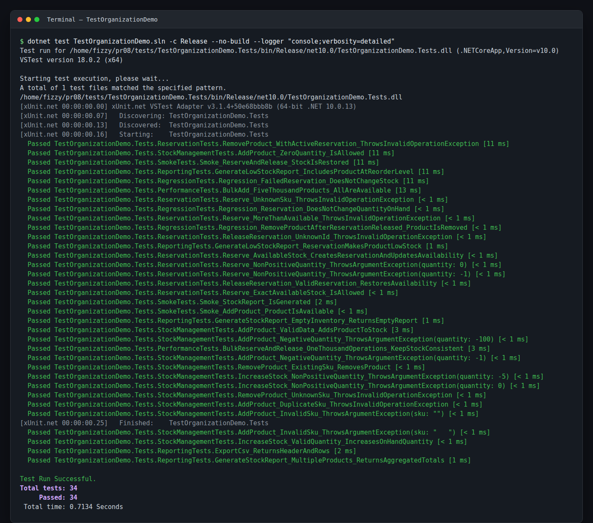
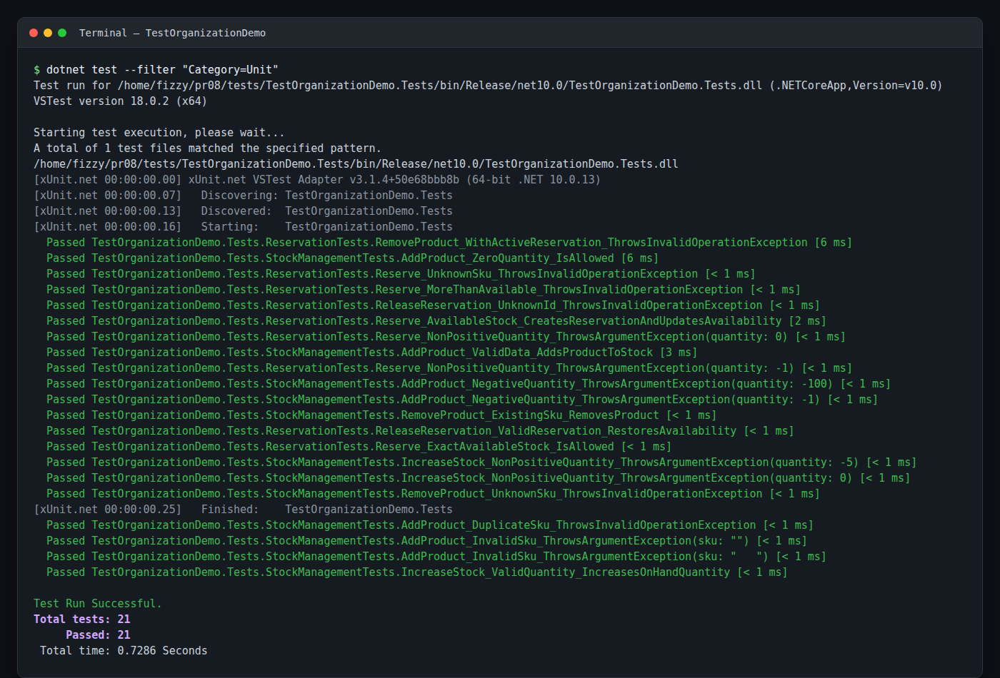
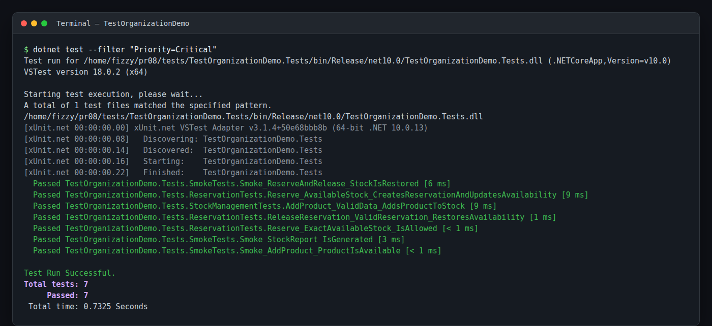
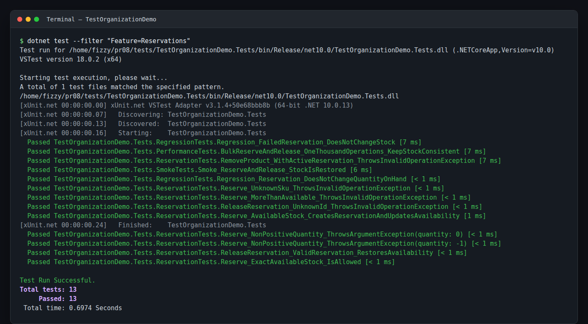
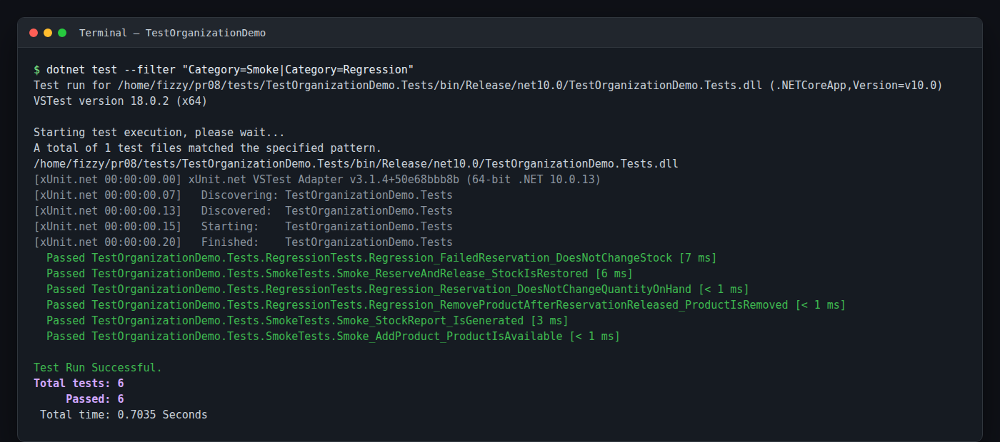
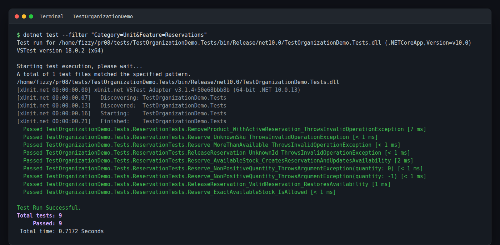

# Практическая работа 8. Организация тестов в группы с помощью Trait и Category

**Вариант 2 — Инвентарная система (InventorySystem)**

## Цель работы

Освоить категоризацию тестов xUnit с помощью атрибутов `[Trait]`, научиться выполнять только нужные группы тестов через `dotnet test --filter` и организовать тестовый набор по категориям, функциям, приоритетам, типам и стабильности.

## Что реализовано

- Решение `TestOrganizationDemo.sln` из двух проектов: консольное приложение и тесты.
- Предметная область варианта 2: товары, остатки, резервы и отчёты по складу.
- `Program.cs` демонстрирует работу склада: добавление товаров, резерв, пополнение, отчёты и CSV-выгрузку.
- Класс `Traits.cs` с централизованными константами для всех Trait-ключей и значений.
- **30 тестовых методов** и **34 тестовых случая** с учётом `[Theory]`.
- **5 категорий**: `Unit`, `Integration`, `Smoke`, `Regression`, `Performance`.
- Использованы все основные Trait-ключи: `Category`, `Priority`, `Feature`, `Type`, `Stability`.
- Отдельные классы для Smoke- и Regression-тестов.
- 6 PNG-скриншотов с фактическим выводом фильтрации `dotnet test --filter`.

## Структура решения

```text
pr08/
├── TestOrganizationDemo.sln
├── README.md
├── .gitignore
├── images/
│   ├── 01-all-tests.png
│   ├── 02-category-unit.png
│   ├── 03-priority-critical.png
│   ├── 04-feature-reservations.png
│   ├── 05-smoke-regression.png
│   └── 06-combined-filter.png
├── src/
│   └── TestOrganizationDemo/
│       ├── Program.cs
│       ├── Models/
│       │   ├── Product.cs
│       │   ├── Reservation.cs
│       │   └── StockReport.cs
│       └── Services/
│           ├── InventoryService.cs
│           └── ReportingService.cs
└── tests/
    └── TestOrganizationDemo.Tests/
        ├── Traits.cs
        ├── StockManagementTests.cs
        ├── ReservationTests.cs
        ├── ReportingTests.cs
        ├── SmokeTests.cs
        ├── RegressionTests.cs
        └── PerformanceTests.cs
```

## Предметная область

`InventoryService` хранит товары и резервы в памяти и поддерживает сценарии:

- добавление товара с указанием SKU, названия, количества, цены и порога пополнения;
- пополнение остатка;
- удаление товара (запрещено, пока есть активные резервы);
- резервирование товара с проверкой доступного количества;
- снятие резерва и восстановление доступного количества;
- получение остатков и списка резервов.

У товара есть:

- `QuantityOnHand` — всего на складе;
- `ReservedQuantity` — зарезервировано;
- `AvailableQuantity = QuantityOnHand - ReservedQuantity`;
- `ReorderLevel` — порог, ниже которого товар считается дефицитным.

`ReportingService` формирует:

- общий отчёт по складу с итогами по количеству и стоимости;
- отчёт по дефицитным товарам (`AvailableQuantity <= ReorderLevel`);
- CSV-выгрузку отчёта.

## Организация Trait

Все ключи и значения вынесены в [`tests/TestOrganizationDemo.Tests/Traits.cs`](tests/TestOrganizationDemo.Tests/Traits.cs):

```csharp
public static class Traits
{
    public const string Category = "Category";
    public const string Priority = "Priority";
    public const string Feature = "Feature";
    public const string Type = "Type";
    public const string Stability = "Stability";

    public static class Categories
    {
        public const string Unit = "Unit";
        public const string Integration = "Integration";
        public const string Smoke = "Smoke";
        public const string Regression = "Regression";
        public const string Performance = "Performance";
    }

    public static class Priorities
    {
        public const string Critical = "Critical";
        public const string High = "High";
        public const string Medium = "Medium";
    }

    public static class Features
    {
        public const string StockManagement = "StockManagement";
        public const string Reservations = "Reservations";
        public const string Reporting = "Reporting";
    }

    public static class Types
    {
        public const string Positive = "Positive";
        public const string Negative = "Negative";
        public const string Boundary = "Boundary";
    }

    public static class Stabilities
    {
        public const string Stable = "Stable";
        public const string Fast = "Fast";
        public const string Slow = "Slow";
    }
}
```

### Ключи Trait

| Ключ | Назначение | Используемые значения |
|---|---|---|
| `Category` | уровень/назначение теста | `Unit`, `Integration`, `Smoke`, `Regression`, `Performance` |
| `Priority` | приоритет выполнения | `Critical`, `High`, `Medium` |
| `Feature` | бизнес-функция | `StockManagement`, `Reservations`, `Reporting` |
| `Type` | характер проверки | `Positive`, `Negative`, `Boundary` |
| `Stability` | стабильность/скорость | `Stable`, `Fast`, `Slow` |

Пример разметки теста:

```csharp
[Fact]
[Trait(Traits.Priority, Traits.Priorities.Critical)]
[Trait(Traits.Type, Traits.Types.Positive)]
[Trait(Traits.Stability, Traits.Stabilities.Fast)]
public void Reserve_AvailableStock_CreatesReservationAndUpdatesAvailability()
{
    // ...
}
```

## Тестовые классы

| Класс | Category | Feature | Методов | Тестовых случаев |
|---|---|---|---:|---:|
| `StockManagementTests` | `Unit` | `StockManagement` | 9 | 12 |
| `ReservationTests` | `Unit` | `Reservations` | 8 | 9 |
| `ReportingTests` | `Integration` | `Reporting` | 5 | 5 |
| `SmokeTests` | `Smoke` | `StockManagement`, `Reservations`, `Reporting` | 3 | 3 |
| `RegressionTests` | `Regression` | `StockManagement`, `Reservations` | 3 | 3 |
| `PerformanceTests` | `Performance` | `StockManagement`, `Reservations` | 2 | 2 |
| **Итого** | | | **30** | **34** |

Распределение по категориям:

| Category | Количество тестовых случаев |
|---|---:|
| `Unit` | 21 |
| `Integration` | 5 |
| `Smoke` | 3 |
| `Regression` | 3 |
| `Performance` | 2 |

## Запуск

Проект приложения создан как консольный (`OutputType=Exe`), точка входа — `src/TestOrganizationDemo/Program.cs`.

Из корня репозитория:

```bash
dotnet restore
dotnet build TestOrganizationDemo.sln -c Release
dotnet test TestOrganizationDemo.sln -c Release
```

Ожидаемый результат: `Total tests: 34`, `Passed: 34`, `Failed: 0`.

Запуск консольной демонстрации:

```bash
dotnet run --project src/TestOrganizationDemo/TestOrganizationDemo.csproj -c Release
```

Пример вывода:

```text
InventorySystem demo
---------------------
Reserved 2 unit(s) of SKU-001.
Increased SKU-002 stock by 3.

Products: 3
On hand: 19
Reserved: 2
Available: 17
Stock value: 1037.83

Low stock report:
  SKU-003 (Monitor): available 2, reorder level 2

Released reservation. SKU-001 available: 10
```

## Фильтрация тестов

### Команды `dotnet test --filter`

```bash
# Только unit-тесты
dotnet test TestOrganizationDemo.sln -c Release --filter "Category=Unit"

# Только интеграционные тесты
dotnet test TestOrganizationDemo.sln -c Release --filter "Category=Integration"

# Smoke и regression отдельно
dotnet test TestOrganizationDemo.sln -c Release --filter "Category=Smoke"
dotnet test TestOrganizationDemo.sln -c Release --filter "Category=Regression"

# По приоритету
dotnet test TestOrganizationDemo.sln -c Release --filter "Priority=Critical"

# По бизнес-функции
dotnet test TestOrganizationDemo.sln -c Release --filter "Feature=Reservations"

# По типу проверки
dotnet test TestOrganizationDemo.sln -c Release --filter "Type=Boundary"

# По стабильности
dotnet test TestOrganizationDemo.sln -c Release --filter "Stability=Fast"

# Комбинация: unit-тесты только для резервов
dotnet test TestOrganizationDemo.sln -c Release --filter "Category=Unit&Feature=Reservations"

# OR: smoke или regression
dotnet test TestOrganizationDemo.sln -c Release --filter "Category=Smoke|Category=Regression"

# Комбинация: unit-тесты граничных значений
dotnet test TestOrganizationDemo.sln -c Release --filter "Category=Unit&Type=Boundary"
```

Операторы фильтра:

- `=` — точное совпадение;
- `&` — логическое И;
- `|` — логическое ИЛИ;
- `~` — содержит подстроку;
- `!` — отрицание (в Linux/macOS shell требует экранирования `\!`).

### Результаты фильтрации

| Фильтр | Найдено тестов |
|---|---:|
| `Category=Unit` | 21 |
| `Category=Integration` | 5 |
| `Category=Smoke` | 3 |
| `Category=Regression` | 3 |
| `Category=Performance` | 2 |
| `Priority=Critical` | 7 |
| `Feature=Reservations` | 13 |
| `Type=Boundary` | 11 |
| `Stability=Fast` | 20 |
| `Category=Unit&Feature=Reservations` | 9 |
| `Category=Smoke` OR `Category=Regression` | 6 |
| `Category=Unit&Type=Boundary` | 9 |

### Скриншоты

Все изображения получены из фактического вывода `dotnet test --filter`, без ручной подмены результатов.

**Все тесты — 34/34:**



**Фильтр `Category=Unit` — 21 тест:**



**Фильтр `Priority=Critical` — 7 тестов:**



**Фильтр `Feature=Reservations` — 13 тестов:**



**Фильтр `Category=Smoke|Category=Regression` — 6 тестов:**



**Комбинированный фильтр `Category=Unit&Feature=Reservations` — 9 тестов:**



### Панель Testing в VS Code

1. Установите расширение **C# Dev Kit**.
2. Откройте папку `pr08` в VS Code и дождитесь загрузки решения.
3. Нажмите иконку **Testing** (колба) на боковой панели.
4. Запустите все тесты кнопкой Run или отдельные тесты/классы через контекстное меню.
5. В строке фильтра панели Testing можно ввести имя класса или метода, например `ReservationTests` или `Smoke_`.
6. Для фильтрации именно по Trait-ключам используйте команды `dotnet test --filter` из раздела выше: они одинаково работают в терминале VS Code, CI и локально. В зависимости от версии C# Dev Kit Trait-значения могут отображаться как теги или не отображаться — CLI-фильтрация в этом случае является надёжным способом.

## Контрольные вопросы

**1. Какие преимущества даёт использование атрибутов Trait?**

Trait позволяет описывать тесты метаданными и запускать нужные группы без изменения кода: только unit-тесты, только smoke, только критичные сценарии, только определённую функцию. Это ускоряет обратную связь, упрощает CI-конфигурацию и делает отчёты понятнее.

**2. Как организовать константы для Trait, чтобы избежать опечаток?**

Вынести ключи и значения в статический класс с вложенными static-классами (`Traits.Categories.Unit`, `Traits.Features.Payments` и т. д.). Тогда работают автодополнение и переименование, а опечатка становится ошибкой компиляции.

**3. Какие критерии можно использовать для категоризации тестов?**

Уровень теста (`Unit`, `Integration`, `System`), бизнес-функция (`StockManagement`, `Reservations`), приоритет (`Critical`, `High`), тип проверки (`Positive`, `Negative`, `Boundary`), стабильность/скорость (`Stable`, `Fast`, `Slow`), владелец, окружение, домен.

**4. Как выполнить только тесты определённой категории?**

```bash
dotnet test --filter "Category=Unit"
```

Можно комбинировать условия:

```bash
dotnet test --filter "Category=Unit&Feature=Reservations"
dotnet test --filter "Category=Smoke|Category=Regression"
```

**5. В чём разница между Category и Feature?**

`Category` описывает уровень и назначение теста: unit, integration, smoke, regression. `Feature` описывает бизнес-функцию: управление остатками, резервы, отчёты. Один и тот же Feature может проверяться тестами разных Category.

**6. Как организовать Smoke- и Regression-тесты?**

Smoke — небольшая группа критичных позитивных сценариев, которая быстро проверяет, что основная функциональность работает, и запускается на каждом билде. Regression — тесты на ранее исправленные ошибки и критические сценарии, которые запускаются перед релизом и после изменений в соответствующей области. В проекте для них созданы отдельные классы `SmokeTests` и `RegressionTests` с Category `Smoke` и `Regression`.

**7. Лучшие практики организации большого количества тестов.**

- Единая таксономия Trait и константы вместо строк.
- Category и Feature на уровне класса, Priority/Type/Stability — на уровне метода.
- Не дублировать слишком много признаков: набор должен быть понятным.
- Держать smoke-набор маленьким и быстрым.
- Изолировать тесты, не зависеть от порядка запуска и общего состояния.
- Настроить отдельные фильтры для локального запуска, CI и релизной проверки.
- Документировать схему Trait в README.

## Соответствие критериям оценки

| Критерий | Выполнение |
|---|---|
| Класс для организации Trait-констант | `Traits.cs` с вложенными классами значений |
| Минимум 5 категорий | `Unit`, `Integration`, `Smoke`, `Regression`, `Performance` |
| Использованы все основные Trait-типы | `Category`, `Priority`, `Feature`, `Type`, `Stability` |
| Отдельные классы Smoke и Regression | `SmokeTests.cs`, `RegressionTests.cs` |
| Минимум 15 тестов | 30 методов / 34 тестовых случая |
| Скриншоты фильтрации | 6 PNG в папке `images/` |
